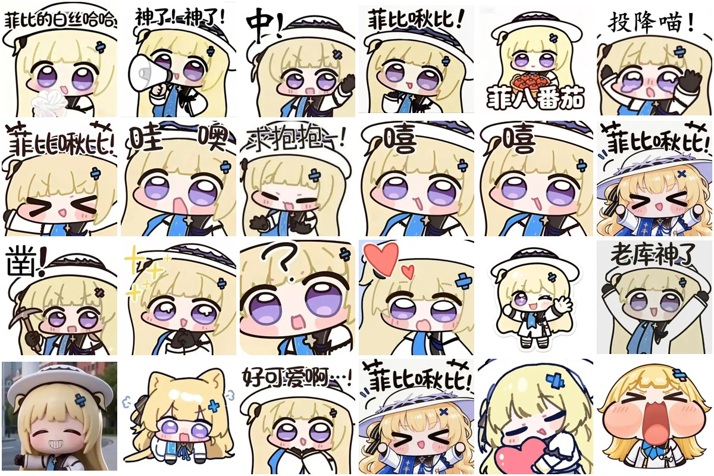

# 菲比表情包

适用于 AstrBot memeManager 的自定义表情包，共 **220 张 WebP 图片**。
图片均来自上传的 `webp.zip`，保留原文件名和原始字节，未重编码。

## 仓库结构

- `manifest.json`：表情包信息、GitHub 来源与分类描述。
- `memes/<category>/*.webp`：按情绪及使用场景分类的图片。
- `previews/cover.jpg`：封面预览。
- `previews/<category>.jpg`：各分类的图片索引。

## 使用

在支持自定义 GitHub 表情包来源的 memeManager 中填写本仓库地址：

`https://github.com/amskle/astrbot-meme-pack-feibi`

分支为 `main`，子目录为 `.`。不同版本的插件入口可能不同。
也可将 `memes` 目录中的分类文件夹导入插件对应的表情存储目录。

## 分类

| 目录 | 场景 | 张数 | 预览 |
| --- | --- | ---: | --- |
| `angry` | 生气／反对 | 10 | [查看](previews/angry.jpg) |
| `baka` | 吐槽／责备 | 9 | [查看](previews/baka.jpg) |
| `color` | 暧昧／坏笑 | 7 | [查看](previews/color.jpg) |
| `confused` | 困惑／疑问 | 18 | [查看](previews/confused.jpg) |
| `fool` | 玩梗／自嘲 | 12 | [查看](previews/fool.jpg) |
| `givemoney` | 要钱／付费 | 4 | [查看](previews/givemoney.jpg) |
| `happy` | 开心／庆祝 | 40 | [查看](previews/happy.jpg) |
| `like` | 喜欢／拥抱 | 17 | [查看](previews/like.jpg) |
| `meow` | 卖萌／喵 | 11 | [查看](previews/meow.jpg) |
| `reply` | 回应／等待反馈 | 12 | [查看](previews/reply.jpg) |
| `sad` | 难过／委屈／道歉 | 16 | [查看](previews/sad.jpg) |
| `see` | 观察／围观 | 13 | [查看](previews/see.jpg) |
| `shy` | 害羞／脸红 | 11 | [查看](previews/shy.jpg) |
| `sigh` | 无语／无奈 | 13 | [查看](previews/sigh.jpg) |
| `sleep` | 睡觉／困倦 | 8 | [查看](previews/sleep.jpg) |
| `surprised` | 惊讶／意外 | 19 | [查看](previews/surprised.jpg) |

分类依据图片文字与画面语义人工整理，部分玩梗图片存在多种解释，可按使用习惯调整。
没有对应图片的分类不建立空目录。

## 结构参考与素材说明

目录及 manifest 字段参考 [astrbot-meme-pack-official-01](https://github.com/anka-afk/astrbot-meme-pack-official-01)，分类描述沿用该项目中对应分类的定义；未复制其表情图片。

素材由仓库维护者提供，相关角色及图片的权利属于各自权利人；本仓库未对这些第三方素材另行授予许可证。参考项目中的许可证不自动适用于本仓库图片。
